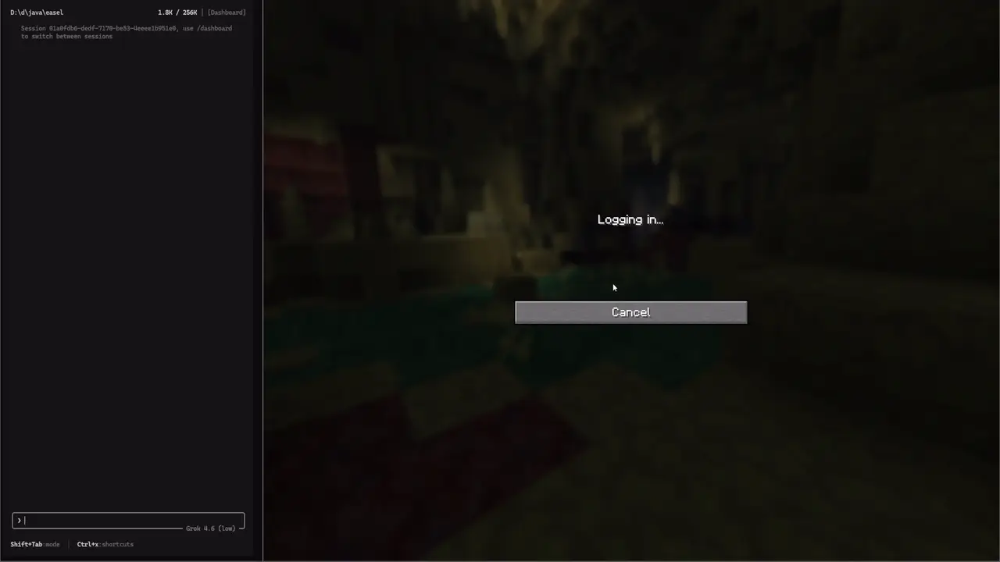

<div align="center">

# Easel

A bridge between an AI Agent and a Minecraft Paper server.



*Basically, this is remote code execution, so please be careful.*

</div>

## Build

```bash
./gradlew jar
```

Move the built jar into the server's plugins directory.

## How to use

One command. For Codex or Grok, swap `claude` for `codex` or `grok`. Chat with an agent as usual.

```bash
claude mcp add --transport http easel http://127.0.0.1:8765/mcp
```

## License

MIT. See [LICENSE](LICENSE).